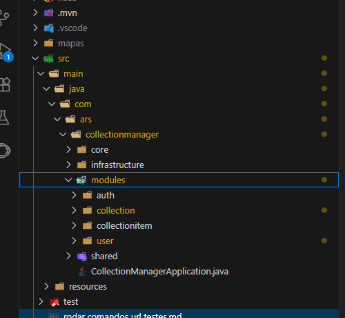
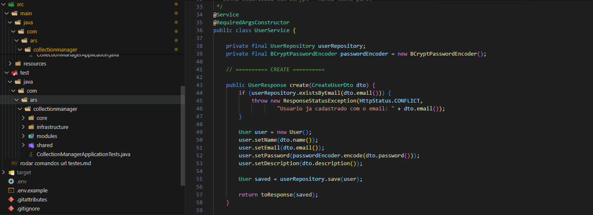
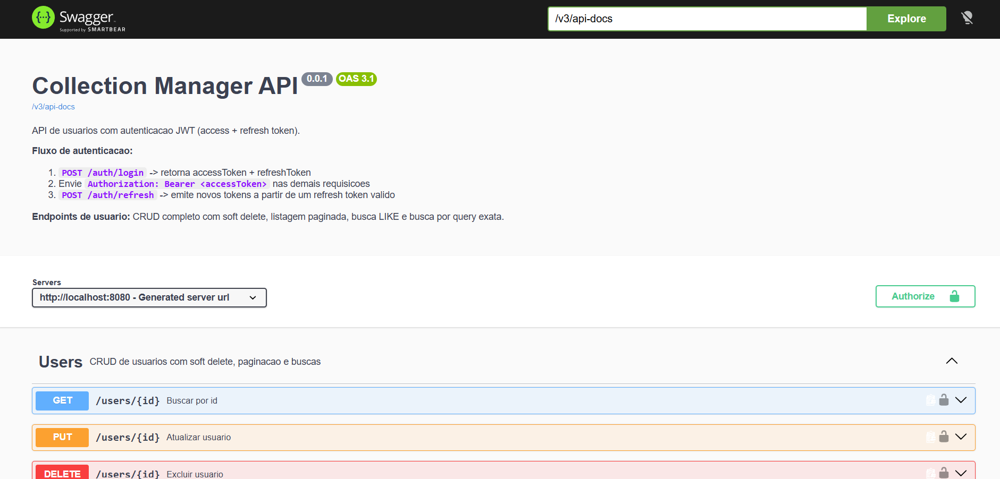
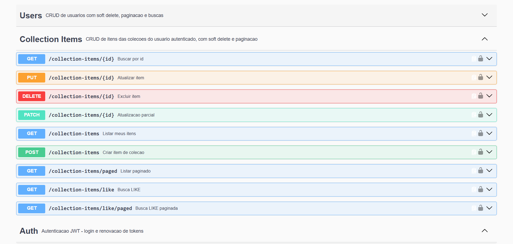
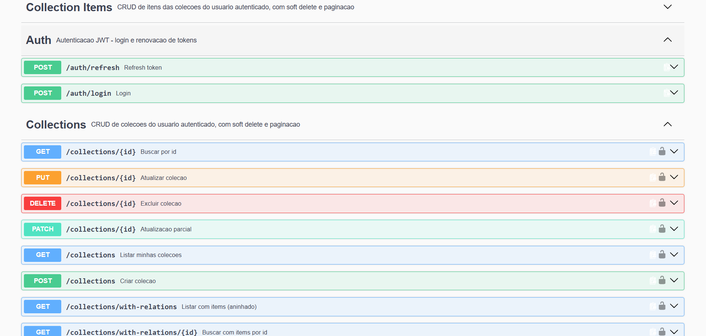
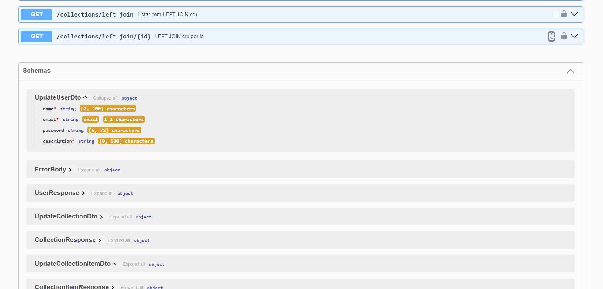

# Collection Manager

[](https://www.oracle.com/java/)
[](https://spring.io/projects/spring-boot)
[](https://www.mysql.com/)
[](https://maven.apache.org/)
[](https://swagger.io/)

Backend REST de **gerenciamento de coleções** com autenticação JWT (access + refresh token), construído em **Spring Boot 4** com arquitetura de **Monólito Modular** — simples, direta e sem camadas desnecessárias.

O usuário se autentica, cria suas coleções e adiciona itens a cada coleção. Todo acesso é **escopado ao dono do token**: você só enxerga os seus dados.

## Índice

- [Stack](#stack)
- [Arquitetura](#arquitetura)
- [Módulos](#módulos)
- [Modelo de Dados](#modelo-de-dados)
- [Endpoints](#endpoints)
- [Segurança](#segurança)
- [Como Rodar](#como-rodar)
- [Testes](#testes)
- [Documentação Swagger](#documentação-swagger)
- [Comandos Rápidos](#comandos-rápidos)
- [Capturas de Tela](#capturas-de-tela)
- [Roadmap](#roadmap)

## Stack

| Camada | Tecnologia |
|--------|------------|
| Linguagem | Java 21 (records, text blocks) |
| Framework | Spring Boot 4.1.1 (Web, Data JPA, Security, Validation) |
| Build | Apache Maven (wrapper `mvnw` / `mvnw.cmd`) |
| Banco | MySQL 8 (Spring Data JPA + `mysql-connector-j`) |
| Autenticação | JWT — `jjwt` 0.12.6 (access 1h / refresh 30h) |
| Senhas | BCrypt (`spring-security-crypto`) |
| Validação | Bean Validation (`spring-boot-starter-validation`) |
| Documentação | springdoc-openapi 3.1.1 (Swagger UI) |
| Testes | JUnit 5 + Mockito + JaCoCo |
| Utilitários | Lombok |

## Arquitetura

**Monólito Modular (sem frescuras)** — 4 áreas de topo, módulos independentes, persistência direta no módulo:

```
src/main/java/com/ars/collectionmanager/
├── core/                       # Global de aplicação
│   ├── GlobalExceptionHandler.java   # Erros -> resposta padronizada
│   └── OpenApiConfig.java            # Info + scheme bearerAuth p/ Swagger
├── infrastructure/             # (futuro) database, cache, http
├── shared/                     # (futuro) types, utils, contracts
├── modules/
│   ├── auth/                   # Login + refresh + JWT
│   │   ├── dtos/                    LoginRequest, LoginResponse, RefreshRequest
│   │   ├── AuthController.java      POST /auth/login, /auth/refresh
│   │   ├── AuthService.java         valida credenciais, gera tokens
│   │   ├── JwtService.java          emite/valida access + refresh
│   │   ├── JwtAuthenticationFilter.java  extrai token na requisicao
│   │   └── SecurityConfig.java      regras de acesso publico/token
│   ├── user/                   # Cadastro e CRUD de usuarios
│   │   ├── entities/                User (@Entity tabela users)
│   │   ├── dtos/                    Create/Update/Patch/Response + relacionais
│   │   ├── enums/                   UserRoleEnum
│   │   ├── UserController.java      14 rotas /users
│   │   ├── UserService.java         CRUD + BCrypt + soft delete + 409
│   │   └── UserRepository.java      extends JpaRepository
│   ├── collection/             # Colecoes do usuario
│   │   ├── entities/                Collection (@Entity tabela collections)
│   │   ├── dtos/                    Create/Update/Patch/Response + relacionais
│   │   ├── CollectionController.java   13 rotas /collections
│   │   ├── CollectionService.java   CRUD + owner do JWT + soft delete
│   │   └── CollectionRepository.java    scoped por owner
│   └── collectionitem/         # Itens de cada colecao
│       ├── entities/                CollectionItem (@Entity tabela collection_items)
│       ├── dtos/                    Create/Update/Patch/Response
│       ├── CollectionItemController.java   9 rotas /collection-items
│       ├── CollectionItemService.java      CRUD + dono herdado da collection
│       └── CollectionItemRepository.java   scoped por owner da collection
└── CollectionManagerApplication.java   # entry point
```

Regras internas de cada módulo:

- `entities/` + `dtos/` + `interfaces/` + `enums/` + `Controller` + `Service` + `Repository`
- Constructor injection com `@RequiredArgsConstructor` (nunca `@Autowired` em field)
- DTOs = `record` (Java 21); entidade = class com Lombok `@Getter/@Setter`
- `Repository extends JpaRepository` direto — sem camada port/adapter
- Erro de negócio = `ResponseStatusException` no Service

## Módulos

| Módulo | Status | Responsabilidade |
|--------|--------|------------------|
| **auth** | ✅ | Login e refresh token. Emite access token (1h) e refresh token (30h) via JWT. Filtro intercepta toda requisição e valida o Bearer. |
| **user** | ✅ | CRUD completo de usuários: criação pública, listagem com paginação/busca LIKE/query, soft delete. Senha BCrypt, nunca retorna na resposta. Papéis via `UserRoleEnum` (USER/ADMIN) e `@PreAuthorize` por endpoint. |
| **collection** | ✅ | Coleções do usuário autenticado. O **dono vem sempre do JWT** (o body nunca aceita `userId`). Código (`code`) único global → 409 em duplicidade. Escopo total: lista só o que é seu; id de outro usuário → 404. |
| **collectionitem** | ✅ | Itens dentro de uma coleção. **Sem `user_id` próprio** — o dono é herdado do `owner` da collection. `code` único **por collection** → 409 na mesma coleção. Soft delete em tudo. |
| **task** | ⏳ | Tarefas com referência a `userId` — planejado em `modules/task`. |

### Endpoints por módulo

| Módulo | Rotas | Total |
|--------|-------|-------|
| auth | login, refresh | 2 |
| user | CRUD + paginação + like + query + with-relations + left-join + specifications | 14 + 6 |
| collection | CRUD + paginação + like + with-relations + left-join + specifications | 13 + 6 |
| collection-item | CRUD + paginação + like + filtro por collection | 9 |
| **Total** | | **43 operações** |

## Modelo de Dados

```
users (1) ──────< (N) collections (1) ──────< (N) collection_items
   │                      │                              │
   └─ id, name, email     └─ id, name, code (unique)     └─ id, name, code (unique por collection)
      password (BCrypt)       user_id (FK)                   collection_id (FK)
      description             owner (@ManyToOne)             collection (@ManyToOne)
      role, deleted_at        deleted_at                     deleted_at
```

- Tabelas criadas automaticamente pelo Hibernate (`ddl-auto=update`) — sem migration
- `user` é palavra reservada do MySQL → tabela se chama **`users`**
- **Soft delete** em todas as entidades (`deleted_at`) — DELETE remove logicamente
- Relações aninhadas disponíveis em 3 formas:

| Rota | Mecanismo | Formato |
|------|-----------|---------|
| `with-relations` | JPQL `LEFT JOIN FETCH` (1 query, sem N+1) | aninhado: user → collections[] → items[] |
| `left-join` | JPQL multi-coluna | linhas cruas: `user \| collection \| item`, null quando não existe |
| `specifications` | `JpaSpecificationExecutor` + `root.fetch` programático | mesmo shape do `with-relations`, join montado em código |

## Endpoints

Base: `http://localhost:8080` · 🔓 = público · 🔒 = requer `Authorization: Bearer <accessToken>`

### Auth

| Método | Rota | Acesso | Descrição |
|--------|------|--------|-----------|
| POST | `/auth/login` | 🔓 | `{email, password}` → `{accessToken, refreshToken}` |
| POST | `/auth/refresh` | 🔓 | `{refreshToken}` → novos tokens |

### Users

| Método | Rota | Acesso | Descrição |
|--------|------|--------|-----------|
| POST | `/users` | 🔓 | Cria usuário (email duplicado → 409) |
| GET | `/users` | 🔒 | Lista todos |
| GET | `/users/paged` | 🔒 | Lista paginada |
| GET | `/users/like` | 🔒 | Busca LIKE por nome/descrição |
| GET | `/users/like/paged` | 🔒 | Busca LIKE paginada |
| GET | `/users/query` | 🔒 | Busca por query |
| GET | `/users/query/paged` | 🔒 | Busca por query paginada |
| GET | `/users/{id}` | 🔒 | Detalhe por id |
| PUT | `/users/{id}` | 🔒 | Atualização completa |
| PATCH | `/users/{id}` | 🔒 | Atualização parcial |
| DELETE | `/users/{id}` | 🔒 | Soft delete |
| GET | `/users/with-relations[/{id}]` | 🔒 | Aninhado via `LEFT JOIN FETCH` |
| GET | `/users/left-join[/{id}]` | 🔒 | Linhas cruas user\|collection\|item |
| GET | `/users/specifications[/{id}]` | 🔒 | Aninhado via `Specification` + `root.fetch` |

### Collections

| Método | Rota | Acesso | Descrição |
|--------|------|--------|-----------|
| POST | `/collections` | 🔒 | Cria coleção (dono = JWT, `code` duplicado → 409) |
| GET | `/collections` | 🔒 | Lista só as do dono |
| GET | `/collections/paged` | 🔒 | Paginada |
| GET | `/collections/like` | 🔒 | Busca LIKE |
| GET | `/collections/like/paged` | 🔒 | Busca LIKE paginada |
| GET | `/collections/{id}` | 🔒 | Detalhe (id de outro usuário → 404) |
| PUT | `/collections/{id}` | 🔒 | Atualização completa |
| PATCH | `/collections/{id}` | 🔒 | Atualização parcial |
| DELETE | `/collections/{id}` | 🔒 | Soft delete |
| GET | `/collections/with-relations[/{id}]` | 🔒 | Coleção → itens aninhados |
| GET | `/collections/left-join[/{id}]` | 🔒 | Linhas cruas |
| GET | `/collections/specifications[/{id}]` | 🔒 | Aninhado via Specification |

### Collection Items

| Método | Rota | Acesso | Descrição |
|--------|------|--------|-----------|
| POST | `/collection-items` | 🔒 | Cria item (dono herdado da collection) |
| GET | `/collection-items` | 🔒 | Lista (`?collectionId=` opcional) |
| GET | `/collection-items/paged` | 🔒 | Paginada |
| GET | `/collection-items/like` | 🔒 | Busca LIKE |
| GET | `/collection-items/like/paged` | 🔒 | Busca LIKE paginada |
| GET | `/collection-items/{id}` | 🔒 | Detalhe |
| PUT | `/collection-items/{id}` | 🔒 | Atualização completa |
| PATCH | `/collection-items/{id}` | 🔒 | Atualização parcial |
| DELETE | `/collection-items/{id}` | 🔒 | Soft delete |

## Segurança

- **JWT dual:** access token (1h) para as requisições + refresh token (30h) para renovar
- **Papéis:** `UserRoleEnum` com `@PreAuthorize` por endpoint
- **Escopo por dono:** coleções e itens filtrados pelo usuário do token — id alheio retorna **404** (sem vazamento de existência)
- **Senhas:** BCrypt, nunca retornadas em resposta
- **Sem token / token inválido:** retorna **403** (Spring Security padrão)
- **Credenciais:** somente no `.env` (gitignorado) — `.env.example` é o template

## Como Rodar

### Pré-requisitos

- JDK **22** (o Lombok quebra no JDK 27)
- MySQL 8 rodando
- Maven Wrapper já incluso no projeto (`mvnw.cmd`)

### 1. Variável de ambiente (PowerShell)

```powershell
$env:JAVA_HOME="C:\Program Files\Java\jdk-22"
```

### 2. Configurar banco

```bash
# criar o database (uma vez)
mysql -u root -p -e "CREATE DATABASE user_login_refresh_list_task;"
```

### 3. Variáveis de ambiente (.env)

Copie o template e preencha:

```bash
cp .env.example .env
```

```env
DB_URL=jdbc:mysql://localhost:3306/user_login_refresh_list_task?createDatabaseIfNotExist=true
DB_USERNAME=root
DB_PASSWORD=sua_senha
JWT_SECRET=sua_chave_secreta
```

### 4. Subir a aplicação

```powershell
.\mvnw.cmd spring-boot:run
```

- App: http://localhost:8080
- Swagger: http://localhost:8080/swagger-ui.html

> As tabelas são criadas automaticamente pelo Hibernate na primeira execução.

## Testes

```powershell
# suíte completa
.\mvnw.cmd test

# apenas os testes unitários (sem necessidade de MySQL)
.\mvnw.cmd test "-Dtest=UserServiceTest,CollectionServiceTest,CollectionItemServiceTest"

# um arquivo só
.\mvnw.cmd test "-Dtest=UserServiceTest"

# um método só
.\mvnw.cmd test "-Dtest=UserServiceTest#mustCreateUser"

# cobertura (gera relatório HTML)
.\mvnw.cmd test jacoco:report
```

- Relatório: `target/site/jacoco/index.html`
- Cobertura: **86+ testes unitários** nos serviços de user, collection e collectionitem — caminhos felizes e tristes (404, 409, 403, escopo cross-user)

## Documentação Swagger

| URL | Conteúdo |
|-----|----------|
| http://localhost:8080/swagger-ui.html | UI visual interativa |
| http://localhost:8080/v3/api-docs | JSON bruto |
| http://localhost:8080/v3/api-docs.yaml | YAML bruto |

Use o botão **Authorize** no Swagger para colar o `accessToken` e testar rotas protegidas.

## Comandos Rápidos

```json
{
  "scripts": {
    "start":    ".\\mvnw.cmd spring-boot:run",
    "debug":    "F5 no VS Code / play no IntelliJ",
    "test":     ".\\mvnw.cmd test",
    "test:one": ".\\mvnw.cmd test \"-Dtest=UserServiceTest\"",
    "test:cov": ".\\mvnw.cmd test jacoco:report",
    "build":    ".\\mvnw.cmd package -DskipTests",
    "clean":    ".\\mvnw.cmd clean"
  }
}
```

## Capturas de Tela

### Código





### Swagger rodando









## Roadmap

- [ ] Módulo **task** (`modules/task`) — tarefas com referência a `userId`
- [ ] Migração Flyway (hoje o Hibernate cria as tabelas com `ddl-auto=update`)
- [ ] Rate limiting nos endpoints de auth
- [ ] CI com cobertura mínima

---

Projeto de estudo — Monólito Modular com Spring Boot, JWT e MySQL.
